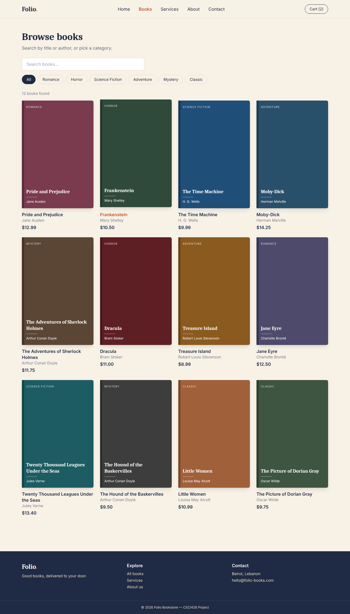
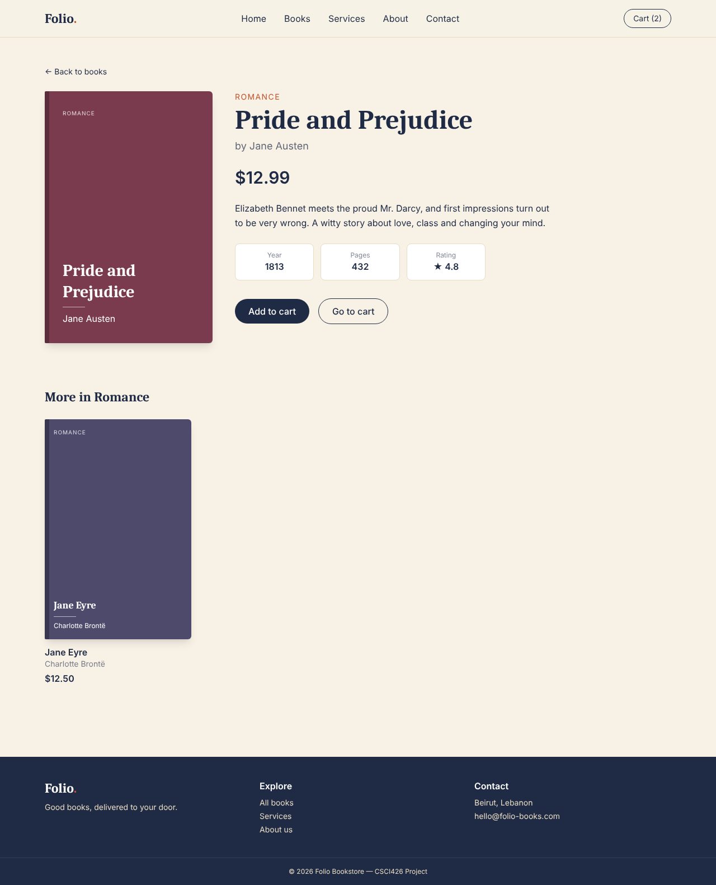
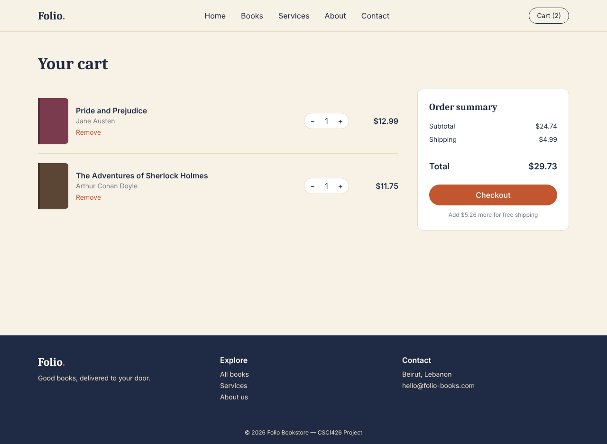
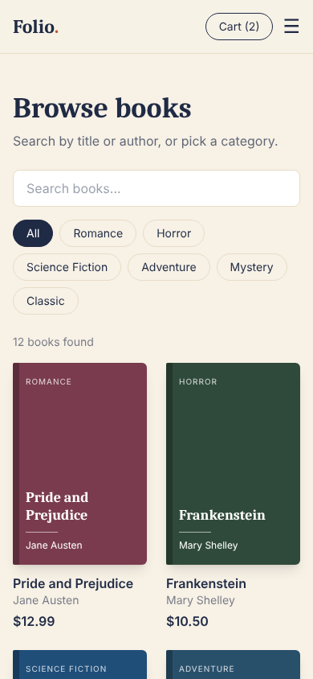
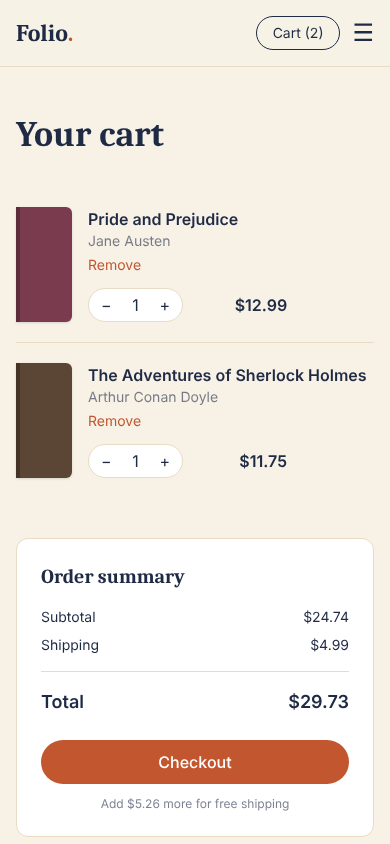

# Folio — Online Bookstore

**CSCI426: Advanced Web Programming — Project Phase 1 (Frontend)**

Folio is a responsive online bookstore built with **React** and **Tailwind CSS**. Users can browse a catalog of classic books, search by title or author, filter by category, open a details page for each book, add books to a cart and place an order.

> Phase 1 covers the frontend only. Book data lives in `src/data/books.js` and the cart is saved in the browser's `localStorage`. A backend will replace both in a later phase.

## Features

- **7 pages:** Home, Books, Book Details (dynamic), Cart, Services, About, Contact (+ a 404 page)
- **Search** books by title or author, and **filter** by category
- **Dynamic page:** `/books/:id` shows any book using the id from the URL
- **Shopping cart:** add/remove books, change quantities, free shipping over $30, checkout
- Cart is **saved in localStorage**, so it survives a page refresh
- **Contact form** with validation (name, valid email, message length)
- **Responsive design:** works on phones, tablets and desktops (hamburger menu on mobile)
- Book covers are drawn with CSS — no copyrighted images

## Technologies

| Technology | Purpose |
|---|---|
| React 18 | Building the user interface with components |
| React Router 6 | Navigation between pages (`HashRouter` so it works on GitHub Pages) |
| Tailwind CSS 3 | Styling and responsive layout |
| React Context | Sharing the cart between pages |
| Git & GitHub | Version control and hosting |

## Project structure

```
src/
├── components/       Reusable pieces used on many pages
│   ├── Navbar.js       Top menu (with mobile hamburger menu)
│   ├── Footer.js
│   ├── BookCover.js    CSS-drawn book cover
│   ├── BookCard.js     One book in a grid
│   └── ScrollToTop.js  Scrolls to top when the page changes
├── context/
│   └── CartContext.js  Cart state + add/remove/update functions
├── data/
│   └── books.js        The list of books
├── pages/            One file per page
│   ├── Home.js
│   ├── Books.js        Catalog with search and filters
│   ├── BookDetails.js  Dynamic page (/books/:id)
│   ├── Cart.js
│   ├── Services.js
│   ├── About.js
│   ├── Contact.js
│   └── NotFound.js
├── App.js            Routes for all pages
├── index.js          Entry point
└── index.css         Tailwind + shared button/input styles
```

## Setup instructions

Requirements: [Node.js](https://nodejs.org) 18 or newer.

```bash
# 1. Clone the repository
git clone https://github.com/<your-username>/folio-bookstore.git
cd folio-bookstore

# 2. Install dependencies
npm install

# 3. Start the development server (opens http://localhost:3000)
npm start

# 4. Build for production (output goes to the build/ folder)
npm run build
```

## Deployment (GitHub Pages)

1. Push the project to a GitHub repository.
2. Run `npm run build`.
3. Install the deploy helper once: `npm install --save-dev gh-pages`
4. Add this script to `package.json`: `"deploy": "gh-pages -d build"`
5. Run `npm run deploy`, then in **Settings → Pages** choose the `gh-pages` branch.

The app uses `HashRouter` and `"homepage": "."`, so it works from any GitHub Pages URL without extra configuration.

## Screenshots

### Home


### Browse books


### Book details (dynamic page)


### Cart


### Services


### About


### Contact


### Mobile view
<p>
  
  
  
</p>

## Credits

All book titles are public-domain classics. Fonts: Fraunces and Inter from Google Fonts. No pre-built templates were used.
